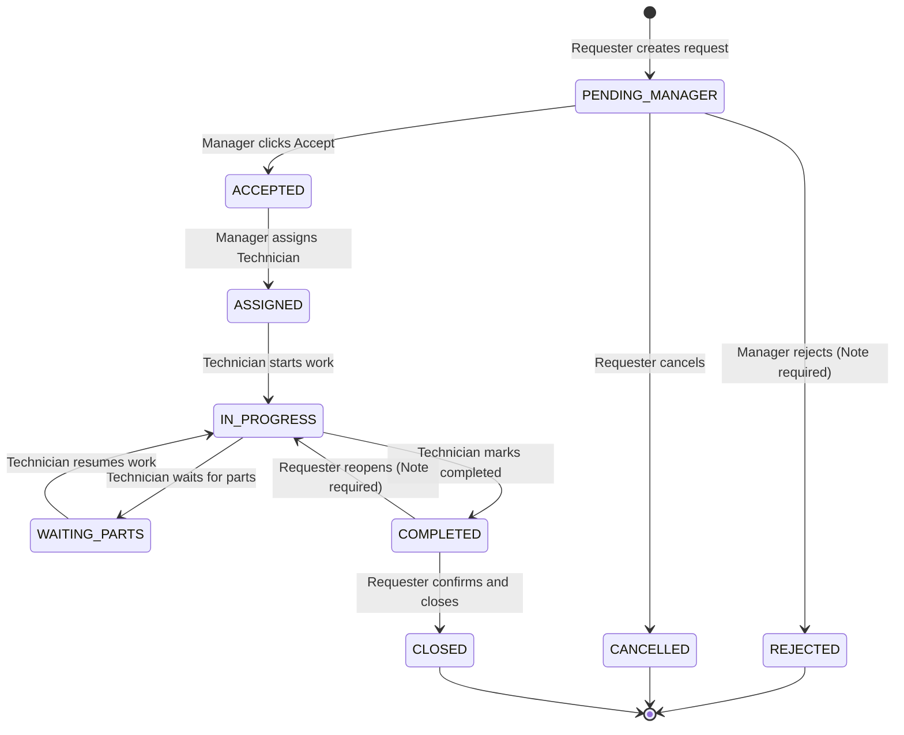

# Fixify State Transition & API Flow

## State Transition Diagram

## Maintenance Lifecycle API Sequence

1. **สร้างใบแจ้งซ่อม:** `POST /api/requests`
   - ระบบเช็ค `location_id` หากเป็นชั้นหรือห้อง จะเดินขึ้นไปตาม `parent_id` จนกว่าจะเจอระดับตึกที่มีหัวหน้างานผูกอยู่ใน `location_managers`
   - บันทึกสถานะเริ่มต้นเป็น `PENDING_MANAGER`
   - บันทึกประวัติใน `request_logs` (action: `CREATE`)

2. **หัวหน้ารับงาน:** `POST /api/requests/:id/accept`
   - ตรวจสอบสิทธิ์ว่าผู้ใช้เป็น MANAGER ที่ดูแลตึกนี้จริง
   - เปลี่ยนสถานะเป็น `ACCEPTED` และบันทึกลง `request_logs`

3. **หัวหน้ามอบหมายช่าง:** `POST /api/requests/:id/assign`
   - ตรวจสอบว่า `technician.manager_id == request.manager_id` และช่าง active
   - บันทึก `technician_id`, `assigned_at` เปลี่ยนสถานะเป็น `ASSIGNED` และบันทึก Log

4. **ช่างเริ่มทำงาน:** `POST /api/requests/:id/start`
   - เปลี่ยนสถานะเป็น `IN_PROGRESS`
   - บันทึกอะไหล่ `POST /api/requests/:id/parts` หรือโน้ต `POST /api/requests/:id/notes` ระหว่างทำ

5. **ช่างส่งมอบงาน:** `POST /api/requests/:id/complete`
   - อัปโหลดรูปหลังซ่อม `POST /api/requests/:id/attachments` (stage: AFTER)
   - บันทึก `completed_at` และเปลี่ยนสถานะเป็น `COMPLETED`

6. **ผู้แจ้งปิดงาน:** `POST /api/requests/:id/close`
   - บันทึก `closed_at` เปลี่ยนสถานะเป็น `CLOSED`
   - ผู้แจ้งให้คะแนนความพึงพอใจ: `POST /api/requests/:id/rating`
